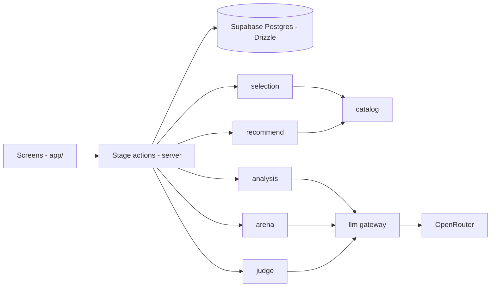
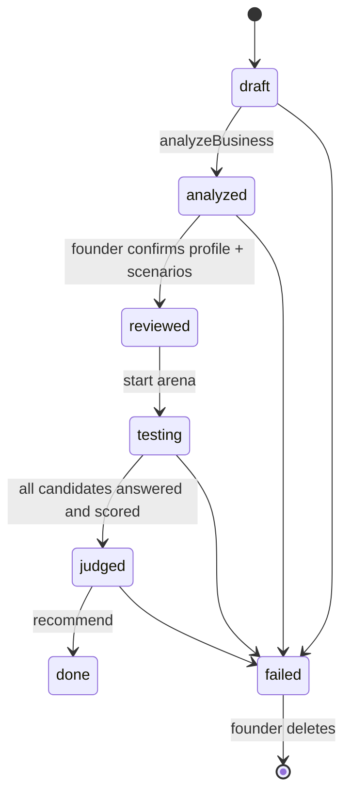
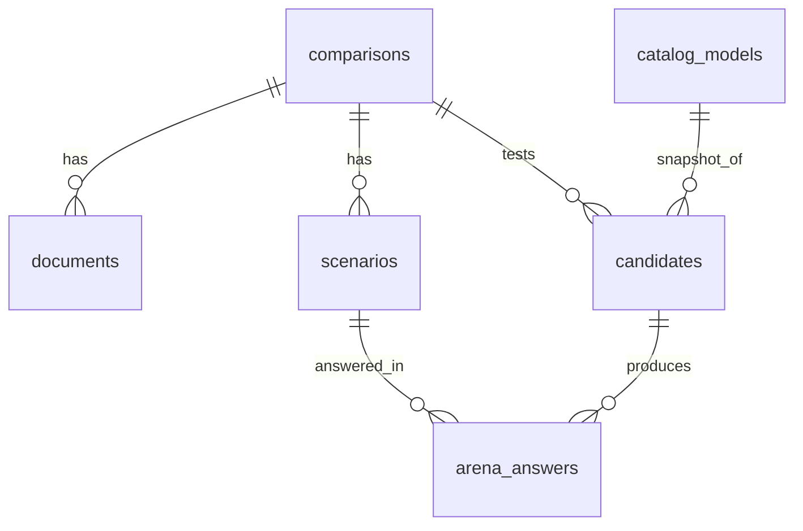
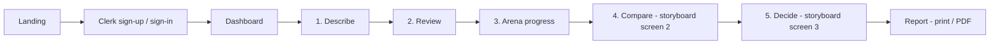

# BenchCraft — System Design Spec

- **Date:** 2026-10-31
- **Status:** Approved in brainstorming, awaiting final spec review
- **Team:** DSG2-Team01 (Ly Yeakkhai — PO/SM, Soeurn Tola, Mak Khemara, Seat Sreylenn, Tho Vicheka)
- **Source documents:** Scrum Project Charter, Business Case

---

## 1. Product summary

BenchCraft recommends the **right-sized AI model** for a founder's business use case.
The founder describes the business and uploads documents. BenchCraft:

1. Understands the business domain (industry × task category).
2. Selects ~5 candidate models from a curated catalog across size tiers.
3. Writes business-specific test scenarios with grading rubrics.
4. Runs an **arena**: every candidate answers every scenario through OpenRouter.
5. A judge model scores the answers.
6. Returns the **top 3** with fit score, monthly cost, the saving against the top-tier model, **one recommendation with reasons**, and **where to buy** it.

**Core principle — "the LLM proposes, code decides."** LLMs produce the domain profile,
the scenarios, the arena answers and the judge scores. Candidate selection, cost,
ranking, saving and recommendation are deterministic pure functions.

**Right-sizing rule:** recommend the *cheapest* model whose *measured* quality meets the
use case's quality bar. Bigger models only win when smaller ones fail.

### 1.1 Scope

| Priority | Capabilities |
|---|---|
| Must have | Sign-up/login · Describe form · Document upload · Domain analysis · Model catalog by category · Automated arena (≈5 candidates × ≈8 scenarios) · Judge scoring · Top 3 comparison · One recommendation with reasons · Monthly cost and saving · Where to buy |
| Should have | Saved past comparisons (dashboard) · Downloadable report (print → PDF) · Answer drill-down per scenario |
| Could have | Plans and pricing section (display only) |
| Not this release | Payment processing · Free-form "ask your own question" chat against models · Team accounts · Multi-turn arena conversations |

> The automated arena is **core scope**. The charter's out-of-scope item ("testing models
> on the founder's own questions") refers to an interactive free-form chat, which remains
> out of scope. Founders can still edit/add scenarios on the Review screen.

### 1.2 Success criteria (from charter)

- New user reaches a recommendation without help, in **under 10 minutes**.
- 100% of successful runs return top 3 + monthly cost + one recommendation with reasons + where to buy.
- Catalog: **≥ 12 models, 5 categories, 3 tiers** (exceeds the charter's ≥ 10 / ≥ 3).
- ≥ 4 of 5 testers rate the result clear and useful.
- Measured API cost per comparison ≤ $0.40 (business case assumption).

---

## 2. Tech stack

| Layer | Choice | Notes |
|---|---|---|
| Framework | Next.js 16 (App Router), React 19, TypeScript | Already installed |
| Styling / UI | Tailwind CSS 4, shadcn/ui, Recharts (via shadcn charts) | Light mode, desktop-first, responsive |
| Auth | Clerk (`@clerk/nextjs`) | Already installed. Rows store `clerkUserId`; no users table, no webhook |
| Database | Supabase Postgres via Drizzle ORM + `postgres` driver | Already installed. Drizzle only (no Supabase JS client, no RLS); server-side only, pooled connection string |
| LLM access | OpenRouter via Vercel AI SDK (`ai` + `@openrouter/ai-sdk-provider`) | One key for analysis, arena and judge |
| Validation | zod | One schema shared by forms, server actions and LLM structured output |
| DOCX parsing | mammoth | PDFs are sent directly to the model as file parts; TXT/MD read as text |
| Testing | Vitest (unit + fixtures), Playwright (one end-to-end flow) | |
| CI | GitHub Actions: lint, typecheck, Vitest on every PR | |
| Hosting | Vercel (preview deploy per PR = shared test environment) | |

All OpenRouter calls set `provider: { data_collection: "deny", zdr: true }`.

---

## 3. Architecture

A single Next.js monolith. Each pipeline **stage** is a short server action that reads and
writes a `comparison` record in Postgres. No background-job service.



### 3.1 Comparison lifecycle



`failed` stores `failedStage`. "Retry this step" restores the status that stage started
from (`draft`, `reviewed` or `testing`) and re-runs only that stage.

Rules:
- Each stage action verifies ownership (`clerkUserId`) and the expected current status, then advances. Repeating an action is idempotent.
- The arena runs **one server call per candidate model, in parallel**, triggered by the Arena screen. Each call answers all scenarios for that model (≈20–40 s) and writes results as it goes.
- Judging runs after all candidates are `done` or `failed` (one call per scenario).
- If the user leaves and returns, the Arena screen re-triggers only candidates still `pending`/`running`-and-stale (no update for > 90 s).

### 3.2 Folder structure

```
src/
  app/                      # routes and screens (Tola)
    page.tsx                # landing
    dashboard/page.tsx
    c/new/page.tsx          # 1. Describe
    c/[id]/review/page.tsx  # 2. Review
    c/[id]/arena/page.tsx   # 3. Arena progress
    c/[id]/page.tsx         # 4+5. Compare + Decide
    c/[id]/report/page.tsx  # Report (print)
  db/                       # Drizzle schema, client, queries (Khemara)
  actions/                  # stage server actions + status transitions (Khemara)
  lib/
    types/                  # shared zod schemas + TS types (contracts)
    llm/                    # the ONLY OpenRouter client (Khemara)
  features/
    intake/                 # form schema, file validation, text extraction (Sreylenn)
    analysis/               # analyzeBusiness (Sreylenn)
    catalog/                # catalog.ts, seed, price sync (Vicheka)
    selection/              # selectCandidates — pure (Vicheka)
    arena/                  # runModel (Vicheka / Sreylenn)
    judge/                  # judgeAnswers (Vicheka)
    recommend/              # cost + recommend — pure (Vicheka)
```

Modules communicate only through types in `lib/types`. No module imports another
module's internals. Changing the AI provider touches only `lib/llm`.

### 3.3 Module contracts

| Module | Signature | Kind |
|---|---|---|
| `lib/llm` | `generateStructured(schema, prompt, opts)`, `generateText(model, messages, opts)` → result + `{ inputTokens, outputTokens, costUsd, latencyMs }` | Gateway: privacy flags, timeouts, retries, cost logging, per-comparison spend cap |
| `features/intake` | `validateFiles(files) → Result`, `toModelParts(files) → ContentPart[]` | Code |
| `features/analysis` | `analyzeBusiness({ description, files, usage }) → { profile: DomainProfile, scenarios: Scenario[], docSummaries }` | LLM |
| `features/catalog` | `getActiveCatalog() → CatalogModel[]`, `syncPrices()`, seed script | Code |
| `features/selection` | `selectCandidates(profile, catalog) → CatalogModel[]` (3–5) | Pure |
| `features/arena` | `runModel(model, systemPrompt, scenarios, opts) → ArenaAnswer[]` | LLM |
| `features/judge` | `judgeScenario(scenario, answers[]) → Score[]` | LLM |
| `features/recommend` | `monthlyCost(...)`, `recommend(candidates, profile, usage) → Recommendation` | Pure |

---

## 4. Data model



All child rows use `ON DELETE CASCADE` from `comparisons`.

### comparisons
| Column | Type | Notes |
|---|---|---|
| id | uuid PK | |
| clerkUserId | text, indexed | Owner |
| title | text | Business name |
| status | enum | `draft, analyzed, reviewed, testing, judged, done, failed` |
| description | text | |
| conversationsPerMonth | integer | From presets (1k / 10k / 50k / 100k) or custom |
| conversationLength | enum | `short, medium, long` |
| domainProfile | jsonb | `DomainProfile`, null until analyzed |
| judgeModelId | text | Recorded for transparency |
| apiCostUsd | numeric(10,4) | Sum of all LLM calls for this comparison |
| error | text | Friendly message when `failed` |
| failedStage | text | Stage to retry |
| createdAt, updatedAt | timestamptz | |

### documents
| Column | Type | Notes |
|---|---|---|
| id | uuid PK | |
| comparisonId | uuid FK | |
| fileName, mimeType | text | |
| sizeBytes | integer | |
| summary | text | AI summary. **Raw files are never stored.** |

### scenarios
| Column | Type | Notes |
|---|---|---|
| id | uuid PK | |
| comparisonId | uuid FK | |
| position | integer | |
| prompt | text | The end-user message the model must answer |
| rubric | jsonb | `string[]` of 2–5 criteria |
| source | enum | `ai, founder` (edited or added by founder) |

### catalog_models
| Column | Type | Notes |
|---|---|---|
| id | text PK | OpenRouter slug, e.g. `google/gemini-2.5-flash-lite` |
| name, provider | text | |
| tier | enum | `small, mid, top` |
| categories | text[] | Task categories it suits |
| priorScores | jsonb | `{ [category]: number 0–100 }` from public benchmarks |
| isReference | jsonb | `{ [category]: boolean }` — the top-tier reference per category |
| languages | text[] | e.g. `["en","km","th"]` |
| contextLength | integer | |
| modalities | text[] | `text`, `image`, `file` |
| inputPricePerMTok, outputPricePerMTok | numeric | USD per million tokens |
| whereToBuy | jsonb | `[{ name, url }]` — provider direct, cloud marketplace, OpenRouter |
| sourceUrl | text | Source for benchmark/price data |
| pricesUpdatedAt | timestamptz | Set by price sync |
| active | boolean | |

### candidates
| Column | Type | Notes |
|---|---|---|
| id | uuid PK | |
| comparisonId | uuid FK | |
| modelId | text FK → catalog_models | |
| tier | enum | Snapshot |
| status | enum | `pending, running, done, failed` |
| inputPriceSnapshot, outputPriceSnapshot | numeric | **Copied at test time**; reports never change retroactively |
| avgScore | numeric | 0–10 |
| passRate | numeric | 0–1 |
| avgInputTokens, avgOutputTokens | numeric | Measured |
| monthlyCostUsd | numeric | |
| rank | integer | 1..n by fit score |
| isRecommended | boolean | |
| reasons | jsonb | `string[]` from templates |
| updatedAt | timestamptz | Used to detect stale runs |

### arena_answers
| Column | Type | Notes |
|---|---|---|
| id | uuid PK | |
| candidateId | uuid FK | |
| scenarioId | uuid FK | |
| status | enum | `done, failed` |
| answer | text | |
| inputTokens, outputTokens, latencyMs | integer | |
| score | numeric | 0–10, null until judged |
| judgeRationale | text | |

### DomainProfile (zod, stored as jsonb)
```ts
{
  industry: string,                 // e.g. "E-commerce / Fashion"
  taskCategory: "support_chat" | "document_qa" | "content_writing" | "extraction" | "coding",
  businessSummary: string,
  languages: string[],              // ISO codes
  needsLongContext: boolean,
  needsVision: boolean,
  riskLevel: "low" | "medium" | "high",
  qualityBar: number,               // low 7.0, medium 8.0, high 8.5 (founder may edit, 5.0–9.5)
  assumptions: string[]             // shown on Review screen
}
```

---

## 5. Recommendation engine

### 5.1 Domain analysis — `analyzeBusiness`
- Input: description, files (PDF as file parts, DOCX via mammoth, TXT/MD as text), usage fields.
- One structured LLM call returns `DomainProfile`, **8 scenarios** with rubrics, and a short summary per document.
- Scenarios must be realistic end-user messages for that business, cover common and hard/edge cases, and be written in the business's primary language.
- `riskLevel` → default `qualityBar`: low 7.0, medium 8.0, high 8.5.

### 5.2 Review (founder step)
Founder can edit every profile field, edit/delete/add scenarios (6–10 total), and see the
candidate list. Confirming moves status to `reviewed`. If the task category or languages
change, candidates are re-selected.

### 5.3 Candidate selection — `selectCandidates` (pure)
1. Filter `active` models where `categories` includes `taskCategory`, all profile `languages` are supported, `contextLength` ≥ 32k if `needsLongContext` (else ≥ 8k), and `image` modality if `needsVision`.
2. Choose **1 top-tier reference** (`isReference[category]`, else highest `priorScore` in `top`), **2 mid**, **2 small**, each tier ordered by `priorScores[category]` descending.
3. At most 2 models per provider. If a tier is short, fill from the adjacent tier.
4. Return 3–5 models. Fewer than 3 eligible → comparison fails with "Not enough catalog coverage for this use case".

### 5.4 Arena — `runModel`
- Same conditions for every model: system prompt built from `businessSummary` (+ document summaries), `temperature: 0.3`, `max_tokens` by length — short 300, medium 600, long 1200.
- Single-turn: one scenario prompt → one answer.
- Token counts taken from OpenRouter usage data.

### 5.5 Judge — `judgeScenario`
- One call per scenario. The judge receives the scenario, its rubric, the business summary, and all candidate answers **anonymized and shuffled** (labels A–E).
- Returns, per label, `score` (0–10, one decimal) and a one-sentence rationale. Labels are mapped back in code.
- Judge model: one fixed strong model configured in `lib/llm/config.ts`, `temperature: 0`. Shown on the results page. A failed answer is not sent to the judge and scores 0.

### 5.6 Cost
```
turns           = { short: 2, medium: 4, long: 8 }[conversationLength]
costPerTurn     = (avgInputTokens × inputPrice + avgOutputTokens × outputPrice) / 1,000,000
monthlyCost     = conversationsPerMonth × turns × costPerTurn
costPer1kConvs  = 1,000 × turns × costPerTurn
```
Turn assumption is shown to the founder.

### 5.7 Recommendation — `recommend` (pure)
- `fitScore = round(avgScore × 10)` (0–100). A scenario is **passed** when `score ≥ qualityBar`.
- Ranking (`rank`) is by fitScore descending; ties broken by lower monthly cost.
- **Recommended = cheapest candidate with `avgScore ≥ qualityBar` AND `passRate ≥ 0.75`.**
- If none qualify: recommend the highest fitScore and set `warning = "No tested model fully met your quality bar"`.
- **Top 3** = recommended + the two other highest fitScores.
- **Saving** = reference top-tier `monthlyCost − recommended.monthlyCost` (monthly and ×12). If the reference failed, use the most expensive successful candidate and add a note. If the recommended model *is* the reference, saving = 0 and the reason states the bigger model was needed.
- **Reasons** are filled templates using real numbers, e.g.:
  - "Scored 8.4/10 against your quality bar of 8.0"
  - "Passed 7 of 8 business scenarios"
  - "Reached 96% of top-tier quality at 1% of the cost"
  - "Supports Khmer and English"
  - "Saves $1,485/month vs Claude Opus"

### 5.8 Expected API cost per comparison
≈ 1 analysis + 40 arena answers + 8 judge calls ≈ 49 calls ≈ **$0.05–$0.20**. Measured value stored in `comparisons.apiCostUsd`.

---

## 6. Screens and flow



| Route | Screen | Content |
|---|---|---|
| `/` | Landing | Value proposition, Nari Boutique example, CTA. Plans section (could-have, display only) |
| `/sign-in`, `/sign-up` | Clerk | Hosted Clerk components |
| `/dashboard` | Dashboard | Past comparisons (title, status, recommended model, date), "New comparison", usage "n / 20 this month", delete |
| `/c/new` | 1. Describe | Business name, description, conversations/month presets, conversation length, file upload (PDF/DOCX/TXT/MD, ≤ 10 MB each, ≤ 5 files), privacy notice above upload → "Analyze my business" |
| `/c/[id]/review` | 2. Review | "Here's what we understood": industry × task, summary, languages, risk, quality bar, assumptions (editable); scenarios (edit/delete/add); candidate list → "Run arena" |
| `/c/[id]/arena` | 3. Arena progress | Live grid models × scenarios, polls every 2 s, resumes after refresh |
| `/c/[id]` | 4. Compare + 5. Decide | Top 3 cards (fit score, pass rate, monthly cost, cost per 1k conversations, tier, ★ recommended); "show all tested"; per-model answer drill-down with judge rationale; cost bar chart. Decide section: recommendation + reasons, saving monthly/yearly, where-to-buy buttons, data source + prices-updated date, judge model |
| `/c/[id]/report` | Report | Print-friendly summary for "Save as PDF" |

Every number shows its source on hover (tooltip).

---

## 7. Error handling, limits, security

### 7.1 Errors
| Case | Behavior |
|---|---|
| LLM 5xx / 429 / timeout | 2 retries, backoff 1 s then 4 s. Timeouts: analysis 60 s, arena answer 45 s, judge 60 s |
| One arena answer fails | Stored `failed`, scores 0. More than 2 of 8 failed → candidate `failed`, excluded from ranking |
| Candidate failure | Continue if ≥ 3 candidates succeed, else comparison `failed` |
| Reference top-tier fails | Saving uses most expensive successful candidate, with a note |
| Invalid structured output | zod validation → one retry with the error appended → else `failed` with "Retry this step" |
| Bad upload | Rejected before any API call with a specific message; unreadable/empty files → ask for description instead |
| Tab closed / refresh | Resume from stored status; only incomplete candidates re-run |
| Double submit | Status check makes stage actions idempotent |

### 7.2 Limits
- 20 comparisons per user per calendar month (count of `comparisons`).
- Files ≤ 10 MB each, ≤ 5 per comparison; scenarios 6–10; `max_tokens` capped by length.
- Per-comparison spend cap **$0.50** enforced in `lib/llm`; exceeding it fails the comparison.
- OpenRouter account: spend alert and credit limit within the $250 API budget.

### 7.3 Security & privacy
- Clerk middleware protects `/dashboard` and `/c/*`; every query filters by `clerkUserId`.
- Raw documents never persisted; only metadata + AI summary.
- OpenRouter: `data_collection: "deny"`, `zdr: true` on every call.
- "Delete comparison" cascades to all child rows.
- Secrets (`OPENROUTER_API_KEY`, Clerk keys, `DATABASE_URL`) server-only.

---

## 8. Model catalog (initial content)

≥ 12 models across 5 categories and 3 tiers, each with OpenRouter slug, tier, categories,
prior scores with source URL, languages, context length, modalities, list prices, and
where-to-buy links. Prices are refreshed by `syncPrices()` from OpenRouter
`GET /api/v1/models` (`pricing.prompt`, `pricing.completion` per token → × 1e6).
The catalog file is reviewed via pull request every sprint (risk mitigation for outdated data).
Exact model list is decided in Sprint 3 from what is currently available on OpenRouter;
each category must have at least one model per tier and one designated reference model.

---

## 9. Testing

| Layer | Tool | Coverage |
|---|---|---|
| Pure engine | Vitest | `selectCandidates`, cost math, `recommend` (pass rule, none qualify, reference failed, recommended = reference, ties), reason templates |
| Schemas | Vitest | zod schemas with valid and invalid samples |
| LLM modules | Vitest + recorded fixtures | `analyzeBusiness`, `runModel`, `judgeScenario` against saved responses (no API spend in CI) |
| Access control | Vitest | User B cannot read/modify/delete user A's comparison |
| Golden case | Manual script each sprint from Sprint 4 | Nari Boutique real run — expect small/mid recommendation and plausible saving |
| End-to-end | Playwright (1 test) | Sign-up → describe → review → arena → results with OpenRouter mocked |
| CI | GitHub Actions | Lint + typecheck + Vitest on every PR |

---

## 10. Delivery plan (one epic per sprint)

| Sprint | Epic | Deliverable | Owners |
|---|---|---|---|
| 1 | Project setup and accounts | Repo conventions, CI, Vercel, Clerk sign-in/up, Drizzle schema + migrations on Supabase, `lib/types` contracts, `lib/llm` gateway, landing + dashboard shell | Khemara, Tola, Yeakkhai |
| 2 | Business profile and intake | Describe screen, file validation/extraction, `analyzeBusiness`, Review screen | Sreylenn, Tola |
| 3 | Model catalog and categories | `catalog.ts` (≥ 12 models / 5 categories / 3 tiers), seed, price sync, `selectCandidates` + tests, candidates on Review | Vicheka |
| 4 | Analysis, matching, recommendation | Arena runner, judge, cost + `recommend` + tests, Arena progress screen, raw results page, golden run | Vicheka, Sreylenn, Khemara |
| 5 | Comparison screen and reporting | Compare + Decide page, drill-down, cost chart, report page, polish, Playwright, 5-tester feedback | Tola, all |

From Sprint 1 the frontend builds against mock data typed by `lib/types`, so UI work is
not blocked by the engine. If Sprint 4 slips, the answer drill-down and cost chart move to
should-have.

---

## 11. Risks addressed by this design

| Business-case risk | Design response |
|---|---|
| Wrong or outdated recommendations | Fit is measured on the founder's own scenarios; prices synced from OpenRouter; price snapshots; source + updated date shown |
| Confidential documents | No raw file storage; ZDR + no-data-collection routing; delete comparison; privacy notice before upload |
| AI/API cost overruns | 20/month limit, file caps, token caps, $0.50 per-comparison cap, OpenRouter spend alert |
| Founders do not trust the result | Review step, visible answers and judge rationales, number-based reasons, judge model disclosed |
| Dependence on one AI provider | All calls behind `lib/llm`; OpenRouter itself routes across providers |
| Small team, tight schedule | Typed contracts enable parallel work; one epic per sprint; explicit slip plan |
